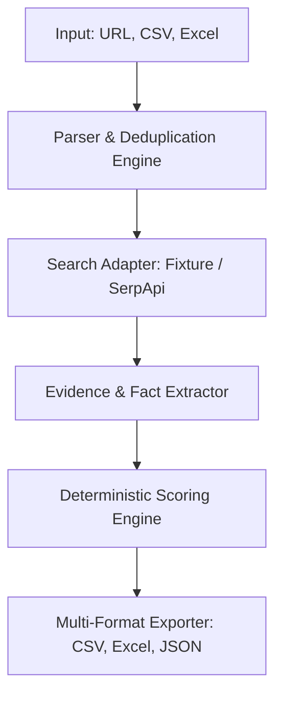

# Trade Show Lead Scoring Agent

> **One-sentence value proposition:** An intelligent, deterministic, and configurable Python agent that extracts, researches, verifies, and prioritizes UK retail brand leads from trade show directories for commercial expansion teams.

---

## Business Scenario & Target Users

Business Development (BD) and E-commerce expansion managers attending retail trade shows need to rapidly filter hundreds of exhibiting brands to identify high-potential partners. 

Default target retail categories:
- **Fashion**
- **Beauty**
- **Home & Living**
*(Other categories are retained and scored objectively against configurable rules).*

> **Important Boundary:** Scores represent **research and outreach priority** under current public evidence and rules, and do not predict purchasing intent, conversion rates, or partnership success. No automated emails or non-public PII collection are performed.

---

## Agent Pipeline Architecture



---

## Tech Stack

- **Python 3.10+**
- **Pandas & OpenPyXL:** Deterministic tabular parsing and multi-sheet Excel generation.
- **Requests & BeautifulSoup:** Secure HTTP fetching and HTML parsing.
- **Pydantic v2:** Rigorous structured data validation and schema management.
- **OpenAI & Anthropic SDKs:** Modular LLM provider integrations for evidence summarization.
- **Pytest:** Automated testing framework.

---

## Demo Quickstart (No API Keys Required)

Run the end-to-end offline demo mode using bundled fixtures:

```bash
python main.py --mode demo --input sample_data/sample_brands.csv --output-dir output/demo
```

Check output files in `output/demo/`:
- `leads.csv` (UTF-8 BOM, Excel compatible)
- `leads.xlsx` (Multi-sheet workbook: Leads, Evidence, Run Summary)
- `leads.json` (Full nested evidence & scoring breakdown)
- `run_summary.json` (Execution metrics and warnings)

---

## Live Mode Configuration

To run with live search and LLM provider APIs:

1. Copy `.env.example` to `.env`:
   ```bash
   cp .env.example .env
   ```
2. Configure your API keys in `.env`:
   ```env
   LLM_PROVIDER=openai
   LLM_MODEL=gpt-4o-mini
   OPENAI_API_KEY=your_openai_api_key
   SEARCH_API_KEY=your_serpapi_key
   SEARCH_API_PROVIDER=serpapi
   ```
3. Run live mode:
   ```bash
   python main.py --mode live --input sample_data/sample_brands.csv --output-dir output/live
   ```

---

## Scoring Formula & Customization

Scoring is strictly computed by deterministic Python logic (`agent/scorer.py`), with LLMs restricted to text extraction and explanation generation.

Default configuration (`config/scoring_config.json`):
- **E-commerce Channel:** 2 points (Verified online purchase entry or official Amazon UK store)
- **Category Match:** 2 points (Matching target retail categories)
- **Representative Products:** 1 point (At least 1 verified GBP representative product)
- **Price Tier:**
  - `premium` (£30–£150 inclusive): 2 points
  - `mass_market` (< £30): 1 point
  - `luxury` (> £150): 0 points
  - `unknown`: 0 points

### Grade Thresholds (Total Range 0–7)
- **A:** 6–7 points
- **B:** 4–5 points
- **C:** 0–3 points

---

## Test Commands

Run the test suite using pytest:

```bash
pytest tests/test_agent.py -v
```

---

## Limitations & Future Improvements

- **Static Directory Parsing:** Static HTML scraping may miss directories that rely heavily on client-side JavaScript rendering or CAPTCHAs (users are advised to use CSV/Excel uploads).
- **Price Comparisons:** Price tiers are based on median GBP prices of representative products, which has inherent limitations across diverse retail sub-categories.
- **Future Enhancements:** Integration with headless browser automation (Playwright) for dynamic exhibitor directories and automated CRM webhook sync.
