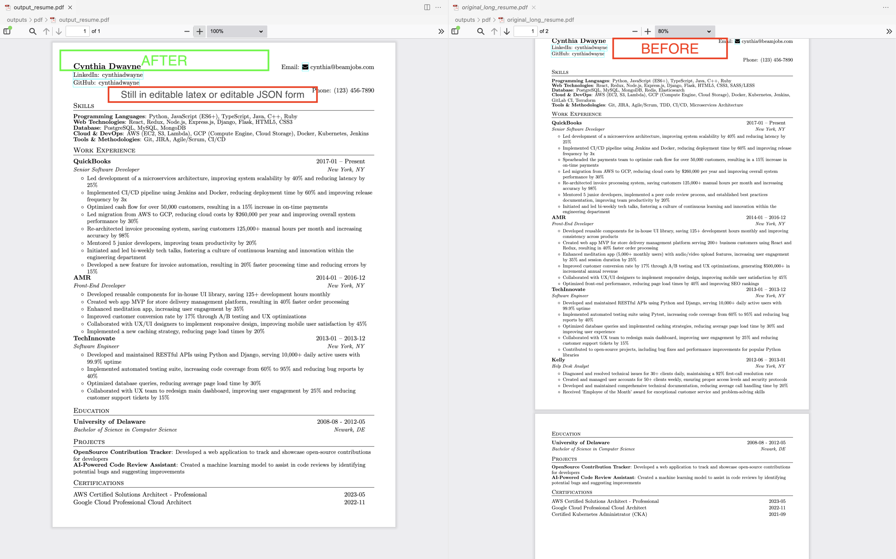
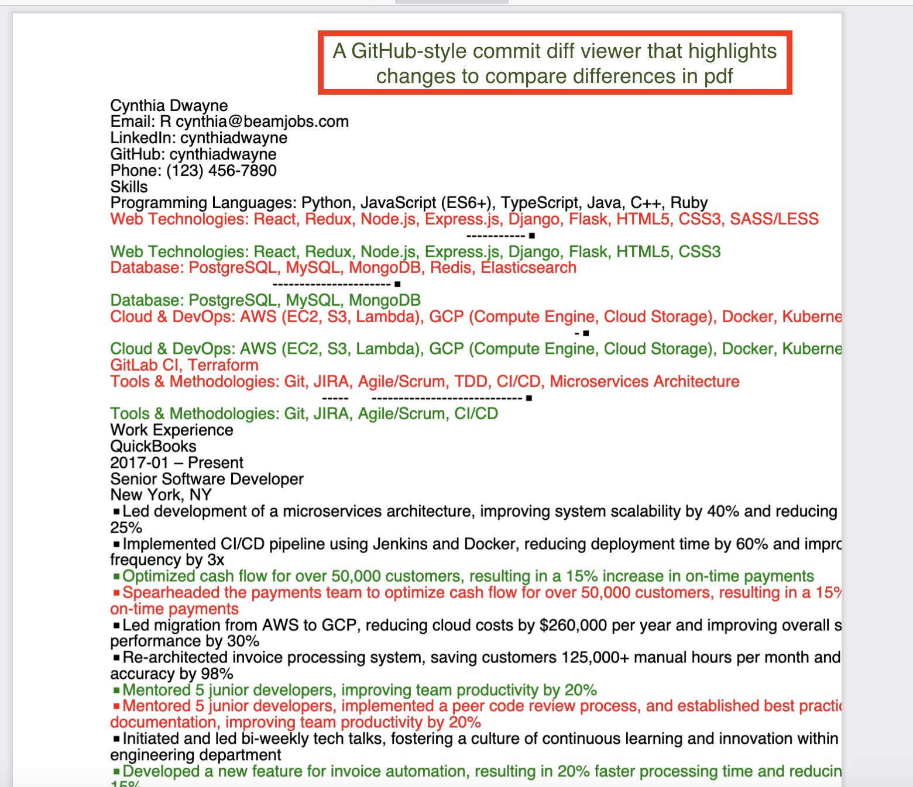

# Agente da Meia Idade (*Mid-Life Agent*)


**O método que usei para me recolocar no mercado de trabalho com ajuda de IA, aberto para você reproduzir.**

> Sou profissional de TI, com mais de 30 anos de carreira. Para voltar ao mercado, organizei a busca de
> emprego como um processo e escrevi uma ferramenta para resolver a parte mais repetitiva. Funcionou:
> **5 meses depois, fui contratado.** Este repositório reúne o que fiz, para ajudar quem está procurando agora.

Aqui você encontra duas coisas:

- **O método:** um passo a passo para organizar a busca, da construção do perfil às retrospectivas que você repete para refinar o processo. Funciona com qualquer assistente de IA.
- **A ferramenta:** uma CLI com agentes de IA que automatiza a parte mais trabalhosa do método, o currículo sob medida para cada vaga.



## Sumário

1. [O método em uma página](#1-o-método-em-uma-página)
2. [Escolha a sua trilha](#2-escolha-a-sua-trilha)
3. [Três cuidados antes de começar](#3-três-cuidados-antes-de-começar)
4. [Trilha A: método com o seu assistente de IA](#4-trilha-a-método-com-o-seu-assistente-de-ia)
5. [Trilha B: automatizar o currículo com a CLI](#5-trilha-b-automatizar-o-currículo-com-a-cli)
6. [Mapa do repositório](#6-mapa-do-repositório)
7. [Contribuindo e licença](#7-contribuindo-e-licença)

## 1. O método em uma página

Procurar emprego vira um trabalho de volume: dezenas de vagas, cada uma pedindo um currículo um pouco
diferente, entrevistas com perguntas previsíveis, mensagens para acompanhar. O método trata isso como
um **pipeline de dados**, em que cada etapa recebe a saída da anterior:

```
PREPARAR     regras do jogo → perfil-mestre → LinkedIn           uma vez
    │
    ▼
ENCONTRAR    busca de vagas → triagem                            em rodadas
    │
    ▼
CANDIDATAR   currículo sob medida → revisão de cobertura         para cada vaga escolhida
             → preparação de entrevista → envio e registro
    │
    ▼
APRENDER     o que gerou resposta? ajuste perfil e prompts       a cada prazo seu, e volta para ENCONTRAR
```

Três ideias sustentam tudo:

1. **Uma única fonte de verdade.** Você escreve uma vez a versão longa e honesta da sua carreira, o `profile_truth.md`. Todo currículo e toda resposta de entrevista saem dele.
2. **A IA propõe, você decide.** Ela pode reordenar, resumir e traduzir. Não pode inventar. Nada sai com o seu nome sem você ler.
3. **Registrar para aprender.** Uma planilha simples mostra quais currículos e fontes de vagas geram resposta. Ao fim de cada prazo que você mesmo define, uma retrospectiva transforma esses dados em ajustes no seu processo.

## 2. Escolha a sua trilha

As duas trilhas seguem o mesmo método. A diferença é **quem produz o currículo**.

| | Trilha A: assistente de IA | Trilha B: CLI com agentes |
|---|---|---|
| **Como funciona** | Você usa prompts prontos em um chat de IA | Você roda um comando e os agentes geram os arquivos |
| **Melhor para** | Começar agora, de qualquer área profissional | Quem programa e vai gerar muitas versões de currículo |
| **Você precisa de** | Assistente de IA, Python 3.9+ e LaTeX para o PDF | Python 3.12 e chave de API de um provedor de IA |
| **Custo** | O do seu assistente | Consumo de API a cada execução |
| **Comece em** | [Seção 4](#4-trilha-a-método-com-o-seu-assistente-de-ia) | [Seção 5](#5-trilha-b-automatizar-o-currículo-com-a-cli) |

**Em dúvida? Comece pela Trilha A.** O perfil-mestre que você escreve nela serve também para a Trilha B.

A CLI cobre apenas parte do método. O restante é igual nas duas trilhas:

| Etapa | Trilha A | Trilha B |
|---|---|---|
| Perfil-mestre | `privado/perfil/profile_truth.md` | `input/<voce>/profile_truth.md` |
| Busca e triagem | Prompts | Prompts: a CLI não busca nem tria vagas |
| Currículo sob medida | Prompt + scripts | **Automático** |
| Revisão de cobertura | Prompt | **Automática por posição**; use também o prompt para ver as lacunas da vaga |
| Preparação de entrevista | Prompt | **Rascunho automático** |
| Envio, registro e aprendizado | Manual | Manual |

## 3. Três cuidados antes de começar

**Seus dados são seus.** Currículo é dado pessoal, e o que você coloca em um prompt é enviado ao provedor de IA.

- `input/`, `data/`, `outputs/` e `privado/` estão no `.gitignore` de propósito. Nunca os versione nem publique os resultados.
- Chaves de API ficam só no `.env`, que também é ignorado pelo git.
- Não escreva no perfil-mestre nada que você não queira enviar ao provedor. Senhas, documentos e dados bancários nunca entram em prompts.

**Você responde pelo que envia.** Nenhuma etapa dispensa a leitura. A IA pode errar datas, exagerar resultados e trocar números. A [revisão de cobertura](meu-emprego-novo-pipeline/docs/05-coverage-review.md) existe para pegar isso, mas a última leitura é sua.

**Golpes de recrutamento existem, e miram quem está procurando.** Recuse entrevista que peça para baixar e rodar código, inclusive um repositório "para achar um bug". Não preencha documento de identidade em candidatura. Pedido de pagamento ou "kit" é golpe. Leia o [guia de segurança](meu-emprego-novo-pipeline/docs/08-golpes-e-seguranca.md) antes da primeira candidatura.

> Este projeto não serve para fabricar experiência, burlar triagem ou candidatar-se em massa sem ler as vagas.

## 4. Trilha A: método com o seu assistente de IA

O tutorial completo está em **[meu-emprego-novo-pipeline/README.md](meu-emprego-novo-pipeline/README.md)**. Ele começa pela sua primeira sessão de trabalho. Cada etapa tem objetivo, passos e critério de conclusão, e você acompanha a [busca completa da Ana Souza](meu-emprego-novo-pipeline/exemplo/README.md), uma persona fictícia.

| # | Etapa | O que você produz | Capítulo | Prompt |
|---|---|---|---|---|
| 0 | Princípios | Instruções do assistente | [00](meu-emprego-novo-pipeline/docs/00-principios.md) | |
| 1 | Perfil-mestre | `profile_truth.md` | [01](meu-emprego-novo-pipeline/docs/01-profile-truth.md) | [prompt](meu-emprego-novo-pipeline/prompts/01-perfil-mestre.md) |
| 2 | Busca de vagas | Lista numerada de vagas | [02](meu-emprego-novo-pipeline/docs/02-busca-de-vagas.md) | [prompt](meu-emprego-novo-pipeline/prompts/02-busca-vagas.md) |
| 3 | Triagem | Vagas por aderência | [03](meu-emprego-novo-pipeline/docs/03-triagem.md) | [prompt](meu-emprego-novo-pipeline/prompts/03-triagem.md) |
| 4 | Currículo sob medida | `resume.json` → `.tex` → PDF | [04](meu-emprego-novo-pipeline/docs/04-curriculo-sob-medida.md) | [criar](meu-emprego-novo-pipeline/prompts/04-curriculo-sob-medida.md) · [ajustar](meu-emprego-novo-pipeline/prompts/04b-ajustar-curriculo.md) |
| 5 | Revisão de cobertura | `coverage_review.md` | [05](meu-emprego-novo-pipeline/docs/05-coverage-review.md) | [prompt](meu-emprego-novo-pipeline/prompts/05-coverage-review.md) |
| 6 | Preparação de entrevista | `interview_prep.md` | [06](meu-emprego-novo-pipeline/docs/06-interview-prep.md) | [prompt](meu-emprego-novo-pipeline/prompts/06-interview-prep.md) |
| 7 | Candidatura e rastreamento | `tracker.csv` | [07](meu-emprego-novo-pipeline/docs/07-rastreamento.md) | [prompt](meu-emprego-novo-pipeline/prompts/07-resumo-tracker.md) |
| 8 | Golpes e segurança | Checklist | [08](meu-emprego-novo-pipeline/docs/08-golpes-e-seguranca.md) | |
| 9 | LinkedIn | Plano de otimização | [09](meu-emprego-novo-pipeline/docs/09-linkedin.md) | [prompt](meu-emprego-novo-pipeline/prompts/09-linkedin.md) |
| 10 | Resultados e lições | Retrospectiva a cada ciclo | [10](meu-emprego-novo-pipeline/docs/10-resultados-e-licoes.md) | [prompt](meu-emprego-novo-pipeline/prompts/10-retrospectiva.md) |

## 5. Trilha B: automatizar o currículo com a CLI

> **Feita por um dev, para devs.** Não é um SaaS polido: é uma CLI hackeável. Cada prompt, agente e template é código simples que você pode ler e alterar.

### Como a CLI funciona

Você entrega seus currículos antigos, o perfil-mestre e a descrição da vaga. Os agentes, escritos com [CrewAI](https://docs.crewai.com), produzem um currículo reposicionado para aquela vaga.

```
input/<voce>/   currículos PDF/DOCX + profile_truth.md (+ about_me.md)
      │  ingest_resume: extrai tudo para um JSON
      ▼
data/<voce>/resume.json   ← sua base; os agentes nunca a alteram
      │  + descrição da vaga
      ▼
5 agentes: rascunho → avaliação ⇄ revisão → relatório → preparação de entrevista
      ▼
outputs/<voce>/<cargo>/   currículo em JSON, LaTeX e PDF + revisão + relatório + preparação de entrevista
```

| Ordem | Agente | O que faz |
|---|---|---|
| 1 | Estrategista de Carreira | Reescreve o resumo e reordena as experiências para o cargo |
| 2 | Gerente de Contratação | Dá uma nota de 1 a 10 e aponta pontos fortes, lacunas e palavras-chave |
| 3 | Editor de Currículo | Aplica o feedback, salva o JSON e gera o PDF |
| 2 ⇄ 3 | Gerente e Editor | Repetem avaliação e revisão até a nota atingir 8.5 |
| 4 | Candidato | Relata a nota final, as melhorias e as lacunas que continuam abertas |
| 5 | Coach de Entrevista | Escreve o guia de preparação para a entrevista a partir do currículo final |

O ciclo entre Gerente e Editor termina quando a primeira destas condições acontecer:

1. a nota atinge **8.5**;
2. uma revisão não melhora a nota, porque insistir em uma lacuna real só empurraria o modelo a inventar;
3. o limite de revisões é alcançado: 3 por padrão, ajustável com `RESUME_MAX_REVISIONS` no `.env`.

A versão final é sempre a de **melhor nota**, mesmo que a última revisão tenha piorado o currículo.

**O que a ferramenta garante e o que não garante:**

- Os prompts mandam usar só o que está nas suas fontes, e o `profile_truth.md` tem prioridade sobre tudo. Isso reduz invenções, mas não as elimina: confira cada fato, principalmente depois de várias revisões.
- Todas as posições são mantidas, da mais recente à mais antiga, sem limite fixo de bullets ou páginas. Por isso o resultado pode ser mais longo do que as duas páginas sugeridas no [capítulo 4](meu-emprego-novo-pipeline/docs/04-curriculo-sob-medida.md).
- **Ficar abaixo de 8.5 é um resultado válido.** A nota é a opinião do modelo sobre a aderência e pode refletir uma lacuna real. Leia o `rating_report.md` e decida; não trate a nota como garantia.
- Cada revisão consome tokens. Uma execução pode chamar o provedor várias vezes mais do que o número de agentes.

### Passo 1: instalar

Requisitos: Python 3.12 e uma chave de API de um provedor. O [LaTeX](https://www.latex-project.org/get/) é opcional: com `pdflatex` instalado o PDF sai no template completo; sem ele, a CLI gera um PDF mais simples com `reportlab`.

Os comandos abaixo são para Linux, macOS ou Git Bash no Windows.

```bash
git clone https://github.com/R238Company/meu-emprego-novo.git
cd meu-emprego-novo
python3.12 -m venv .venv         # no Windows: py -3.12 -m venv .venv
source .venv/bin/activate        # no Git Bash: source .venv/Scripts/activate
pip install -r requirements.txt
cp .env.example .env
```

### Passo 2: escolher o provedor de IA

Abra o `.env` e preencha `LLM_PROVIDER` e a variável correspondente. **O arquivo vem com `bedrock` como padrão:** troque se você não usa AWS.

| `LLM_PROVIDER` | Preencha | Modelo padrão |
|---|---|---|
| `anthropic` | `ANTHROPIC_API_KEY` | Claude Sonnet 4.6 |
| `openai` | `OPENAI_API_KEY` | GPT-4o |
| `gemini` | `GOOGLE_API_KEY` | Gemini 2.5 Flash |
| `grok` | `XAI_API_KEY` | Grok 3 |
| `bedrock` | `AWS_PROFILE` | Veja [Usar com AWS Bedrock](#usar-com-aws-bedrock) |

### Passo 3: testar com o exemplo fictício

Antes de usar seus dados, gere o currículo de "Dev Procurando", um dev Full-Stack inventado. O teste faz chamadas reais ao provedor e consome créditos.

```bash
mkdir -p input/dev_procurando data/dev_procurando/job_profiles
cp examples/dev_procurando/profile_truth.md examples/dev_procurando/job_desc.md input/dev_procurando/
cp examples/dev_procurando/resume.json data/dev_procurando/
cp examples/dev_procurando/job_profiles/*.txt data/dev_procurando/job_profiles/

python main.py --person dev_procurando --job --lang en
```

Quando terminar, o resultado estará em `outputs/dev_procurando/senior_full_stack_engineer_react_node_example_corp/`. Compare com o [PDF de referência](examples/dev_procurando/resume.pdf).

### Passo 4: preparar os seus dados

1. **Crie a sua pasta.** Escolha um identificador sem espaços, como `maria_dev`, e coloque nela pelo menos um currículo atual em PDF ou DOCX:
   ```bash
   mkdir -p input/maria_dev
   ```
2. **Escreva o `profile_truth.md`** em `input/maria_dev/`. Siga o [capítulo 1](meu-emprego-novo-pipeline/docs/01-profile-truth.md) e use o [modelo](meu-emprego-novo-pipeline/templates/profile_truth.md) ou o [exemplo da CLI](examples/dev_procurando/profile_truth.md). Acrescente uma seção `## ❌ NÃO INCLUIR` com o que nunca pode aparecer no currículo. O que está nesse arquivo vale mais que qualquer PDF.
3. **Opcional: crie um `about_me.md`.** Peça a uma IA que entreviste você sobre a carreira e salve a transcrição em `input/maria_dev/about_me.md`. Os agentes usam esse arquivo como evidência complementar.
4. **Gere o JSON base:**
   ```bash
   python -m src.scripts.ingest_resume --person maria_dev
   ```
5. **Revise `data/maria_dev/resume.json` e corrija o que estiver errado.** Ele é a base de todos os currículos. Os agentes nunca o alteram, mas rodar o `ingest_resume` de novo **sobrescreve o arquivo**, inclusive as suas correções.

### Passo 5: gerar o currículo para uma vaga

1. Cole a descrição da vaga em `input/maria_dev/job_desc.md`.
2. Rode os agentes:
   ```bash
   python main.py --person maria_dev --job             # currículo em português
   python main.py --person maria_dev --job --lang en   # currículo em inglês
   ```
3. Pegue o resultado em `outputs/maria_dev/<cargo>/`. A pasta recebe o nome do cargo identificado na vaga:
   ```
   outputs/maria_dev/<cargo>/
   ├── json/resume.json          # conteúdo do currículo
   ├── latex/output_resume.tex   # versão editável
   ├── pdf/output_resume.pdf     # o currículo final
   ├── coverage_review.md        # auditoria de cobertura por posição
   ├── rating_report.md          # notas de cada avaliação, motivo da parada e lacunas abertas
   └── interview_prep.md         # rascunho de preparação para entrevista
   ```

### Passo 6: revisar antes de enviar

A CLI termina aqui, mas o método não. Volte ao tutorial:

1. Leia o PDF inteiro e confira cada data, cargo e número ([checklist](meu-emprego-novo-pipeline/docs/04-curriculo-sob-medida.md#conferência-final-checklist)).
2. Leia o `rating_report.md` e o `coverage_review.md` e rode o [prompt de revisão](meu-emprego-novo-pipeline/prompts/05-coverage-review.md) para listar as lacunas da vaga.
3. Reescreva o `interview_prep.md` com as suas palavras ([capítulo 6](meu-emprego-novo-pipeline/docs/06-interview-prep.md)).
4. Candidate-se você mesmo e registre no tracker ([capítulo 7](meu-emprego-novo-pipeline/docs/07-rastreamento.md)).

### Trabalhar com famílias de vagas

Você não precisa de uma versão do zero para cada anúncio. Salve um perfil curto para cada família de vagas e gere de uma vez:

```bash
mkdir -p data/maria_dev/job_profiles
# crie um .txt por família, por exemplo data/maria_dev/job_profiles/engenheira_dados.txt

python main.py --person maria_dev --list-roles             # lista os perfis
python main.py --person maria_dev --role engenheira_dados  # gera um perfil
python main.py --person maria_dev --all                    # gera todos
```

Veja um [perfil de exemplo](examples/dev_procurando/job_profiles/senior_fullstack_engineer.txt). O resultado fica em `outputs/maria_dev/<perfil>/`.

### Referência de comandos

| Comando | O que faz |
|---|---|
| `python main.py --person <voce> --job` | Gera a partir de `input/<voce>/job_desc.md` |
| `python main.py --person <voce> --job caminho/vaga.md` | Gera a partir de outro arquivo |
| `python main.py --person <voce> --role <perfil>` | Gera um perfil de `job_profiles/` |
| `python main.py --person <voce> --all` | Gera todos os perfis |
| `python main.py --list-people` | Lista as pessoas em `data/` |
| `--lang en` | Gera em inglês (padrão: `pt-BR`) |
| `--provider anthropic` | Troca o provedor só nesta execução |

Defina `PERSON=<voce>` no `.env` para não repetir `--person`.

### Comparar com o currículo original

Para ver um diff colorido entre dois PDFs, copie-os para `outputs/pdf/` com estes nomes exatos e rode o script:

```bash
mkdir -p outputs/pdf
cp caminho/do/original.pdf outputs/pdf/original_long_resume.pdf
cp outputs/<voce>/<cargo>/pdf/output_resume.pdf outputs/pdf/output_resume.pdf
python src/scripts/run_compare_pdf.py
```

O resultado fica em `outputs/pdf/compare_diff.pdf`.



### Usar com AWS Bedrock

Crie um perfil restrito no AWS CLI, adapte [infra/aws/bedrock-policy.json](infra/aws/bedrock-policy.json) trocando `123456789012` pelo ID da sua conta e configure o `.env`:

```dotenv
LLM_PROVIDER=bedrock
AWS_PROFILE=mid-life-agent
AWS_DEFAULT_REGION=us-east-1
BEDROCK_MODEL_ID=us.anthropic.claude-opus-4-6-v1
BEDROCK_FALLBACK_MODEL_ID=us.anthropic.claude-sonnet-4-6   # vazio desativa o fallback
BEDROCK_EXTRACTION_MODEL_ID=deepseek.v3.2
BEDROCK_MAX_TOKENS=16384
```

As tentativas extras e o único fallback para o Sonnet valem apenas para throttling ou indisponibilidade. Erros de permissão e de validação são propagados.

### Problemas comuns

| Sintoma | Causa e solução |
|---|---|
| Erro de Bedrock ou AWS sem você querer usar AWS | O `.env` ainda está com `LLM_PROVIDER=bedrock`. Troque o provedor |
| `Nenhum arquivo PDF ou DOCX encontrado` | O `ingest_resume` precisa de ao menos um currículo em `input/<voce>/` |
| Erro sobre `.doc` e `antiword` | Salve o arquivo como `.docx` ou instale o `antiword` |
| `O LLM retornou JSON inválido` | A resposta bruta fica em `data/resume_raw.txt`. Rode o `ingest_resume` de novo |
| `No such file` para `data/<voce>/resume.json` | Faltou gerar o JSON base (Passo 4) |
| `Profile not found` | O nome em `--role` deve ser igual ao do `.txt`. Confira com `--list-roles` |
| PDF com layout simples | `pdflatex` não encontrado ou falhou, e a CLI usou o `reportlab`. Instale o LaTeX |

Testes offline: `python -m unittest discover -s tests -v`.

## 6. Mapa do repositório

```
.
├── README.md                      # você está aqui
├── meu-emprego-novo-pipeline/     # O MÉTODO
│   ├── README.md                  #   tutorial completo, etapa por etapa
│   ├── docs/                      #   capítulos de aprofundamento (00 a 10)
│   ├── prompts/                   #   prompts prontos para adaptar
│   ├── templates/                 #   arquivos em branco para começar
│   ├── scripts/                   #   validação, JSON → LaTeX, checagem de privacidade
│   └── exemplo/                   #   fluxo completo da persona Ana Souza
├── main.py                        # A FERRAMENTA: ponto de entrada da CLI
├── src/                           #   agentes, provedores de IA e scripts
├── prompts/                       #   prompts dos agentes
├── resume/                        #   geração do LaTeX e do PDF
├── tools/                         #   ferramentas usadas pelos agentes
├── examples/dev_procurando/       #   exemplo fictício da CLI
├── tests/                         #   testes offline
├── infra/aws/                     #   política de exemplo para o Bedrock
└── spec/                          #   especificação original (histórico; o código atual a substitui)
```

Pastas que ficam só na sua máquina: `input/`, `data/`, `outputs/` e `meu-emprego-novo-pipeline/privado/`.

## 7. Contribuindo e licença

Veja [CONTRIBUTING.md](CONTRIBUTING.md). São especialmente bem-vindas adaptações para outras áreas profissionais, novos templates de currículo e relatos de golpes sem nomes reais. Nunca inclua dados pessoais reais em issues ou PRs.

Se este material ajudar você a conseguir uma vaga, conte a sua história em uma issue.

Licença MIT, baseada no projeto original de Rushi Chaudhari ([0xrushi](https://github.com/0xrushi)). Veja [LICENSE](LICENSE).
